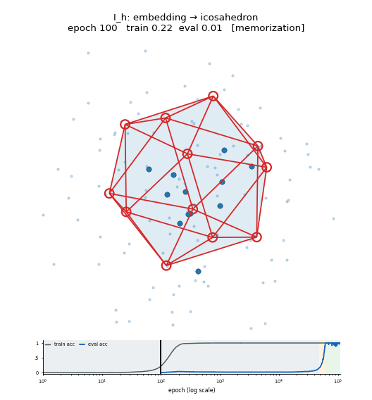
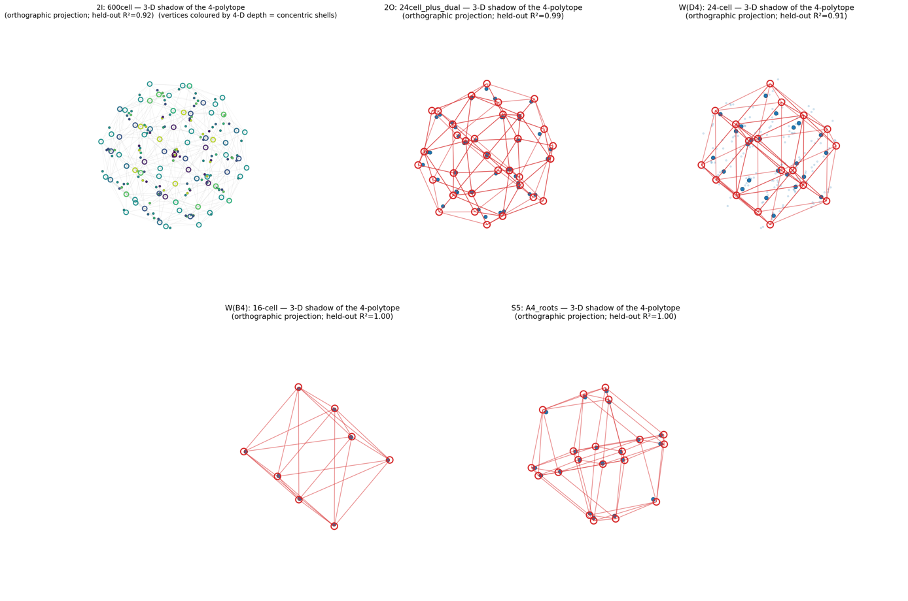

# Grokking finite groups → recovering their geometry

When a small network groks a finite group's multiplication table, where does the
group's **geometry** go? This repo trains 1-layer transformers and MLPs on the
Cayley tables of order-12 … 384 groups and shows that the grokked embedding
concentrates almost all of its energy in the group's lowest-dimensional faithful
("geometric") irrep — so a *linear* read-out of the embedding reconstructs the
group's defining **polytope / root system**, verified out-of-sample.

The headline picture: the embedding of **I_h = A5 × C2** crystallizing onto the
12 vertices of an **icosahedron** as it groks.



…and the 4-dimensional groups, projected to 3-D shadows of their "x-cells":



## Results at a glance

Held-out R² of a cross-validated ridge map *embedding → true polytope coordinates*
(tautology-proof: it predicts the coordinates of group elements held out of the
fit). High R² ⇒ the geometry is really there, not an artifact of the projection.

| Group | order | recovered object | dim | held-out R² |
|---|---|---|---|---|
| **I_h = A5×C2** | 120 | icosahedron | 3 | **0.999** |
| **W(B4)** | 384 | 16-cell (4-orthoplex) | 4 | **1.00** |
| **S5 = W(A4)** | 120 | A4 root system | 4 | **1.00**\* |
| **2O** (binary octahedral) | 48 | 24-cell + dual | 4 | **0.99** |
| **W(A3) = S4** | 24 | cuboctahedron | 3 | **0.96** |
| **2I** (binary icosahedral) | 120 | 600-cell | 4 | **0.92** |
| **W(D4)** | 192 | 24-cell | 4 | **0.91**\* |
| **PSL(2,7) = GL(3,2)** | 168 | Fano plane / 6-simplex | 6 | **0.99** |
| **A5** | 60 | icosahedron | 3 | 0.78† |

\* sharpest right after grok; the geometry can drift under continued weight decay
(`shadow3d.py` auto-picks the peak-decode frame). † capped by the two
Galois-conjugate 3-dim irreps over ℚ(√5) — architecture-independent.

Negative controls that *don't* cleanly recover geometry are just as informative:
**W(B3) = O_h** groks but spreads across its many 3-dim irreps (no clean
octahedron); **A6** and **2T** don't grok at the data budget used; **W(G2)** is
too small for a reliable held-out decode. Recovery requires the model to
concentrate in the *specific* geometric irrep — grokking alone is not enough.

Full write-up: **[RESULTS.md](RESULTS.md)**.

**New — continuous groups:** the same program extended past finite groups: train on
(approximate) **SU(2) composition** with continuous encodings and a matched **SO(3)
control** (one `abs()` apart), and the network builds each group's own Peter–Weyl
representation theory — **half-integer spin sectors emerge only for the double
cover**. Pilot write-up: **[RESULTS_SU2.md](RESULTS_SU2.md)**; code in
`core/su2*.py`, `experiments/su2_train.py`.

## Repository layout

```
core/             library: group builders, rep theory, quaternion/Weyl geometry, models
experiments/      training + analysis + figure/GIF scripts (run as `python -m experiments.X`)
gallery/          all curated visuals  ──────────────────────────────┐
  grokking_gifs/    embedding → polytope convergence animations       │ see
  shadows_3d/       3-D shadows of the 4-polytopes (gif + png/svg)    │ gallery/
  polytopes/        static decoded-polytope figures (transformer/mlp/weyl) │ README.md
  interactive_3d/   rotatable plotly HTML                              ┘
RESULTS.md        detailed cross-group findings
data/             checkpoints (.pt) + snapshots (.npz)  — NOT in git; see "Data" below
```

`core/` and `experiments/` stay at the repo root so `from core import …` and
`python -m experiments.<script>` work unchanged.

## Setup

Requires Python 3.11+ and [uv](https://docs.astral.sh/uv/).

```bash
uv sync
```

## Data (checkpoints & snapshots)

Trained checkpoints (381 MB) and embedding time-series snapshots (173 MB) ship
**separately** (`data.zip`) to keep the repo lean. Unzip it at the repo root so
it lands in `data/{transformer,mlp,weyl}/` — every script's default paths point
there. Without it you can still browse `gallery/`, and you can regenerate
everything from scratch by training (below).

## Reproducing the work

```bash
# 1. Train + snapshot all groups (sequential; CUDA strongly recommended).
#    transformer driver: experiments/aws_train.py   MLP driver: experiments/mlp_train.py
bash experiments/run_gif2.sh           # all groups, dense early snapshots -> data/

# 2. Decode geometry + render the static polytope figures
uv run python -m experiments.polytope_figures --task 2O --ckpt data/transformer/2O_s1/2O_P48_d128_h4_mlp512_s1_grok10k.pt

# 3. Rebuild every gallery GIF (convergence + 3-D shadows) from data/
bash experiments/build_gifs2.sh

# 4. Cross-group rep-theory / decode summary
uv run python -m experiments.summary_groups
```

Key method notes (the *why* behind the numbers) live in
[RESULTS.md](RESULTS.md) — e.g. why raw PCA is unconvincing and the held-out
decode is the real evidence, the Galois-conjugate (√5↔−√5) relabeling needed for
A5/2I, and the W(D4) triality caveat.

## Also here: modular-multiplication interpretability

The same codebase trains the original decoder-only transformer on
**a·b = c (mod P)** (commutative monoid; J-class / cyclic structure) — the
project this grew out of. Those scripts (`core.trainer`, `experiments.train_sweep`,
`attention_embedding`, `embedding_fft`, `pca_fve`, `ov_principal_angles`, `fve`,
`character_fitting`, `mlp_frequencies`) take `--P` instead of `--task`; P=165 is
the reference modulus.

```bash
uv run python -m experiments.train_sweep --Ps 165 --num_runs 5
uv run python -m experiments.attention_embedding --P 165 --seed 1
```

## Turning this into a git repo

```bash
unzip icosahedral-grokking.zip && cd icosahedral-grokking
git init && git add . && git commit -m "Grokking finite groups: geometry recovery"
# optional, for the trained models:
unzip ../icosahedral-grokking-data.zip   # -> data/
```

`.gitignore` already excludes `.venv/`, `data/`, `logs/`, and caches.
