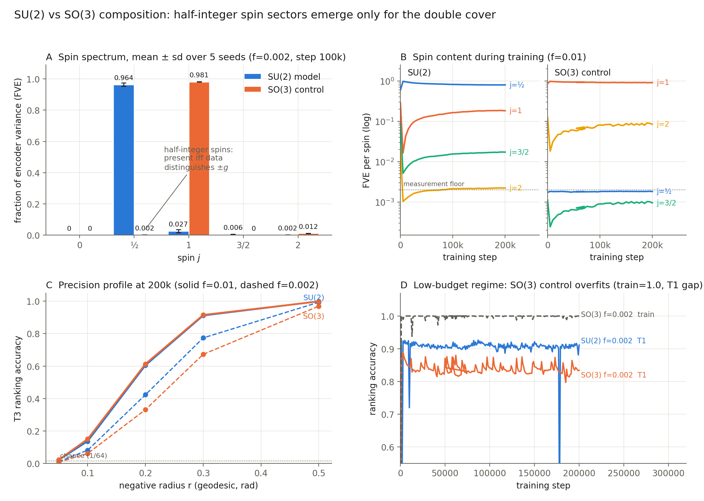

# SU(2) vs SO(3): half-integer spin sectors emerge only for the double cover

**Claim under test.** When a generic network learns the *composition law* of a compact
continuous group, does it internalize the group's harmonic (Peter–Weyl) structure — and
does it learn the group's **global topology**, not just its Lie algebra? SU(2) and SO(3)
share the Lie algebra 𝔰𝔲(2) ≅ 𝔰𝔬(3) but differ globally: SU(2) is the double cover, and
only SU(2) admits half-integer spin (spinor) representations. The diagnostic is
basis-independent and binary: *half-integer isotypic blocks appear in the learned
representation iff the model was trained on the double cover.*

**Status: confirmed across 5 seeds per condition, with causal evidence** (ablations,
score–character fits, and a composition test). Working details and the full task list
live in `summary/report.md`.



## Setup

Everything is continuous — no tokens, no finite vocabulary anywhere.

- **Elements.** Haar-random unit quaternions q ∈ S³ ≅ SU(2).
- **Observation map (frozen).** Ψ(q) = exp(α⟨q, hᵢ⟩), i = 1…32 fixed Haar landmarks
  (α = 3, standardized). The **SO(3) control** uses |⟨q, hᵢ⟩| — the only difference
  between conditions is this absolute value, which makes Ψ even (Ψ(q) = Ψ(−q)), i.e.
  the data determine elements only up to sign: the same task on the quotient group.
- **Task (candidate ranking).** Given Ψ(a), Ψ(b) and K = 64 candidates, identify the
  product: the positive is (ab)·exp(ξ), ξ ~ 𝒩(0, σ²I₃) (σ = 0.2); 63 frozen Haar
  negatives at ≥ 0.5 rad from the positive class; cross-entropy over the K scores.
  The Bayes-optimal rule ranks by geodesic distance to ab; its accuracy (the noise
  ceiling) is 0.951.
- **Model (~0.3M params).** Encoder-factorized scorer: z_a = E(Ψ(a)), z_b = E(Ψ(b));
  h = MLP([z_a, z_b]); score = ⟨h, E_c(Ψ(c))⟩. The encoder activations z(g) play the
  role of the embedding matrix in the finite-group analyses. AdamW, lr 1e-3, weight
  decay 1.0.
- **Data.** Pool of N = 2048 Haar elements; training on a frozen fraction f of the N²
  ordered pairs. **Evaluation:** T1 = held-out pairs of pool elements; T2 = fresh
  pairs of never-seen elements; T3 = exact product vs negatives at fixed geodesic
  radius r.
- **Analysis.** FVE of z onto sampled, jointly-orthonormalized Wigner-D bases per spin
  (measurement floor ≈ 0.2%); z(g) vs z(−g); 2π-rotation holonomy; held-out ridge
  decodes to q (odd, spin-½) and qqᵀ (even, spin-1); interventions, character fits and
  composition tests (`experiments/su2_causal.py`).

## Results (5 seeds per condition, mean ± sd at step 100k, N=2048)

| condition | T2 | FVE j=½ | FVE j=1 | cos(z(g),z(−g)) | R²(q) | R²(qqᵀ) |
|---|---|---|---|---|---|---|
| **SU(2)** f=0.002 | 0.901 ± 0.006 | **0.964 ± 0.010** | 0.027 ± 0.009 | −0.95 ± 0.02 | 0.998 | 0.984 |
| **SU(2)** f=0.01 | 0.921 ± 0.003 | **0.835 ± 0.010** | 0.148 ± 0.010 | −0.72 ± 0.02 | 0.995 | 0.896 |
| **SO(3)** f=0.002 | 0.842 ± 0.015 | 0.0023 ± 0.0004 | **0.981 ± 0.001** | +1.000 ± 0.000 | −0.016 | 0.997 |
| **SO(3)** f=0.01 | 0.883 ± 0.003 | 0.0023 ± 0.0004 | **0.917 ± 0.008** | +1.000 ± 0.000 | −0.012 | 0.999 |

### 1. The double-cover signature (replicated)

In every seed, the SU(2) models concentrate encoder variance in the spin-½ spinor
block: the representation is odd under the center, reverses sign under a 2π rotation
(negative holonomy), and the quaternion is linearly decodable (R² = 0.998). In every
seed of the SO(3) control, all half-integer blocks sit at the 0.2% measurement floor,
variance concentrates in spin 1 (then spin 2), the representation is exactly even, and
the quaternion is not decodable while qqᵀ is. Each condition builds the
lowest-dimensional faithful irrep of its own group — the continuous counterpart of the
finite-group result in `RESULTS.md` (2O/2I spinor irreps).

### 2. Causal evidence (5 seeds; `experiments/su2_causal.py`)

Interventions on the argument encoders, with D_c = P[s(a,b,ab) > s(a,b,−ab)] the
center-discrimination probability:

| metric (mean ± sd over seeds) | SU(2) f=0.01 | SO(3) f=0.01 |
|---|---|---|
| D_c, intact | **1.0000 ± 0.0000** | 0.5000 ± 0.0000 |
| D_c, spin-½ ablated | 0.503 ± 0.006 | 0.500 |
| task acc, spin-½ ablated | **0.026 ± 0.002** (chance 0.016) | 1.000 ± 0.000 (no-op) |
| task acc, spin-1 ablated | 1.000 ± 0.000 | **0.027 ± 0.003** |
| score–character fit R² | 0.974 ± 0.006 on **χ_{1/2}** | 0.876 ± 0.014 on **χ_1** |

A double dissociation, with zero seed variance in its sign: ablating the spin-½
component (by parity projection or by subtracting the component of z predictable from
D^{1/2}) is fatal for the SU(2) model and a no-op for the SO(3) control; ablating
spin-1 transposes the pattern. The trained scorer is, to good approximation, a single
character function of ab c⁻¹ — the logit form of Group Composition via Representations
(Chughtai et al., 2023) built on each group's lowest faithful irrep. A **composition
test** goes beyond location-of-information claims: ridge probes for the quaternion fit
on z compose algebraically to match both the true product and an independent probe on
h (median cosine 0.998 / 0.995; pair-shuffled controls at 0) — the internal product
state carries the *composed* representation, which lookup-table accounts do not
predict.

### 3. No delayed generalization at any training fraction

f ∈ {0.0002, …, 0.01} (839 – 41,943 pairs; 300k steps; evaluations every 500 steps):
every run reaches 90% of its final test accuracy within 500–1000 steps and is flat
thereafter. Lowering f widens a *persistent* train–test gap (SU(2): 0.06 → 0.27;
SO(3): 0.12 → 0.36) but never produces a memorize-then-generalize transition. Notably,
even at f = 0.0002 with train accuracy 1.000 and a 0.27 gap, the SU(2) encoder keeps
97.6% of variance in spin-½ with R²(q) = 0.993 — **memorization coexists with the
group-structured representation rather than competing with it**, in contrast to the
circuit-competition account of grokking on finite algebraic tasks. We attribute the
absence of the delay to the smooth structured encoding (a continuous encoder
generalizes partially from the first steps, unlike free token embeddings).

### 4. Candidate count concentrates the spectrum and sharpens resolution

K ∈ {64, 128, 256} at f = 0.01 (one seed): held-out accuracy tracks the falling Bayes
ceiling (0.951 / 0.936 / 0.922) at ~0.96 of ceiling; fine resolution improves
substantially (T3 at r = 0.2: 0.62 → 0.74 → 0.92); and the spin spectrum
**concentrates** (FVE j=½: 0.85 → 0.87 → 0.975, score–χ_{1/2} fit R² = 0.989).
Because χ_{1/2}(ab c⁻¹) is monotone in geodesic distance, ranking by the fundamental
character is Bayes-optimal at any resolution — higher spins are not required for
resolution, and the models with the purest spin-½ representations resolve best.

### 5. The quotient task is uniformly harder

The SO(3) control generalizes below SU(2) at every f, with the deficit widening from 4
points (f = 0.01) to 9 points (f = 0.0002) of T2. Cause not yet identified (candidate
explanations: conditioning of the even encoding near its fold; the geometry of RP³
vs S³).

## Caveats

- The absence of half-integer blocks in the SO(3) control is partially by
  construction (an even input forces an even representation). The informative content
  is the SU(2) side — nothing forces a dominant, clean spinor block, yet it appears in
  every seed — and the Peter–Weyl identity of what each condition builds.
- Remaining mechanism-level gaps: the patched composition test, per-argument
  equivariance (a fixed linear M_k with M_k M_{k'} ≈ M_{kk'}), and quantitative
  comparison of fitted character coefficients to the heat-kernel envelope. See
  `summary/report.md` Task list.
- K-sweep results are single-seed; the K = 256 runs used batch 2048 (memory), others
  4096.

## Reproduce

```bash
uv run python -m core.su2                      # self-tests
bash experiments/run_su2_queue.sh              # 26-run sweep (K, f, seeds)
uv run python -m experiments.su2_causal --run_dir data/su2/su2_N2048_f0.01_s0
uv run python -m experiments.su2_seed_summary  # aggregate across seeds
```

Logs, checkpoints and per-run causal JSONs land in `data/su2/<run>/` (not in git);
seed aggregates in `summary/seed_summary.json`.
